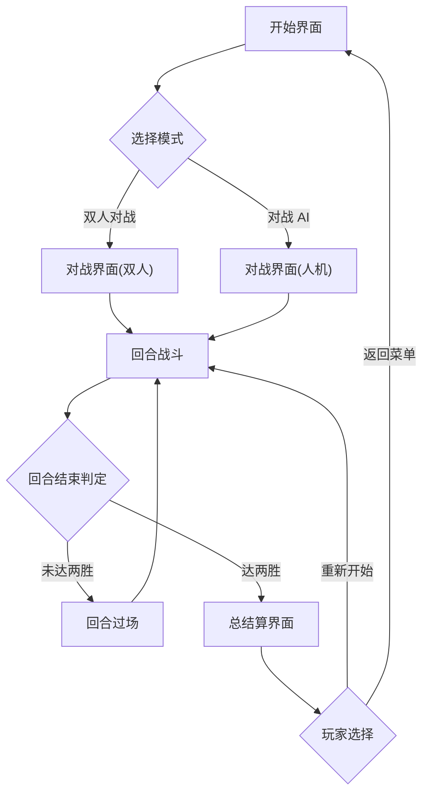

# 产品需求文档（PRD）— 像素机甲对战

## 1. 产品概述
像素机甲对战是一款复古 16 位像素风格的本地对战格斗小游戏。两位玩家（或人机）各操控一台像素机甲，在科幻竞技场中通过移动、攻击、防御与特殊技能进行对决，三局两胜决定最终胜负。
- 解决问题：提供一个即开即玩、无需联网、画面有辨识度的轻量对战 Demo
- 目标用户：复古游戏爱好者、像素美术爱好者、想在浏览器中快速对战休闲的玩家

## 2. 核心功能

### 2.1 用户角色
无需注册，本地即开即玩。两种对局身份：
| 身份 | 进入方式 | 核心权限 |
|------|----------|----------|
| 玩家1（赤焰机甲） | 默认 | 键盘左侧键位操控 |
| 玩家2（苍蓝机甲） | 双人模式 / 人机模式 | 键盘右侧键位操控 / AI 自动操控 |

### 2.2 功能模块
1. **开始界面**：游戏标题动画、模式选择（双人对战 / 对战 AI）、操作说明、开始按钮、像素背景动效
2. **对战界面**：竞技场场景、双机甲、血条、能量条、回合数、倒计时、回合提示动画、命中特效
3. **结算界面**：胜负展示、本局战绩、重新开始 / 返回菜单按钮

### 2.3 页面详情
| 页面名称 | 模块名称 | 功能描述 |
|----------|----------|----------|
| 开始界面 | 标题区 | 像素字体标题、霓虹辉光、扫描线背景 |
| 开始界面 | 模式选择 | 双人对战 / 对战 AI 切换 |
| 开始界面 | 操作说明 | 双方键位图示 |
| 对战界面 | 角色控制 | 移动、跳跃、轻攻击、重攻击、防御、特殊技能 |
| 对战界面 | 战斗系统 | 血量计算、伤害判定、防御减伤、能量积攒与消耗 |
| 对战界面 | 回合系统 | 三局两胜、回合切换过场、KO 判定、平局超时判定 |
| 对战界面 | HUD | 双方血条、能量条、回合比分、倒计时 |
| 结算界面 | 胜负展示 | 胜方机甲特写、胜利标语 |
| 结算界面 | 操作区 | 重新开始 / 返回主菜单 |

## 3. 核心流程
玩家进入开始界面 → 选择对战模式 → 进入对战界面 → 双方战斗至一方血量归零或时间结束 → 回合结算过场 → 累计胜负 → 任一方先胜两局 → 进入总结算界面 → 重新开始或返回菜单

## 4. 用户界面设计

### 4.1 设计风格
- **整体风格**：复古 16 位像素风 + CRT 显像管质感（扫描线、暗角、轻微色差）
- **主色调**：深紫黑底色（#0d0221）+ 霓虹品红（#ff2a6d，玩家1）+ 霓虹青蓝（#05d9e8，玩家2）+ 警示黄（#f9f871，能量）
- **按钮风格**：像素描边立体按钮，按下有像素位移反馈
- **字体**：像素显示字体 `Press Start 2P`（标题/HUD）+ `VT323`（正文说明）
- **布局**：上方 HUD（血条/能量/回合），中央对战舞台，底部地面阴影
- **图标/像素风格**：机甲与特效全部为手绘像素 sprite，无矢量素材

### 4.2 页面设计概览
| 页面名称 | 模块名称 | UI 元素 |
|----------|----------|---------|
| 开始界面 | 标题区 | 大号像素标题、品红/青双色辉光、扫描线滚动 |
| 开始界面 | 模式选择 | 两个像素按钮，选中高亮描边 |
| 开始界面 | 操作说明 | 键位方块图示，分左右两列 |
| 对战界面 | HUD 顶部 | 左右血条（带像素分段）、能量条、中央回合比分与倒计时 |
| 对战界面 | 舞台 | 像素竞技场背景（远景城市轮廓+霓虹灯）、地面网格 |
| 对战界面 | 角色 | 32×40 像素机甲，含待机/行走/攻击/防御/受击帧 |
| 对战界面 | 特效 | 命中火花、能量弹、护盾光圈、KO 闪屏 |
| 结算界面 | 胜负展示 | 胜方机甲放大特写、`VICTORY`/`DEFEAT` 像素字 |
| 结算界面 | 操作区 | 重新开始 / 返回菜单像素按钮 |

### 4.3 响应式
- 桌面优先（键盘对战需要物理键盘）
- Canvas 固定逻辑分辨率 480×270（16:9 像素风），通过 CSS 等比缩放适配窗口，保持像素硬边
- 移动端展示提示：建议使用桌面键盘游玩（Demo 聚焦桌面体验）

### 4.4 像素场景指引
- **环境/氛围**：赛博朋克废墟竞技场，夜空 + 远景霓虹城市剪影
- **光照**：整体暗调，机甲自带霓虹轮廓光，攻击时屏幕短暂泛光
- **构图**：双方机甲分立舞台左右，中央留出战斗空间，地面有透视网格
- **交互/动画**：待机呼吸、行走踏步、攻击挥拳、防御护盾、受击后退抖动、KO 倒地
- **后处理**：CRT 扫描线叠加、轻微暗角、可选色差抖动
- **素材来源**：全部像素 sprite 由代码内像素数据数组程序化生成，无外部图片依赖，性能可控
